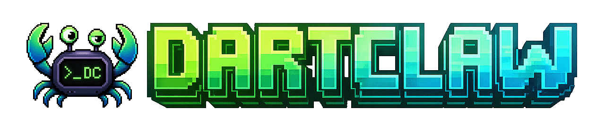
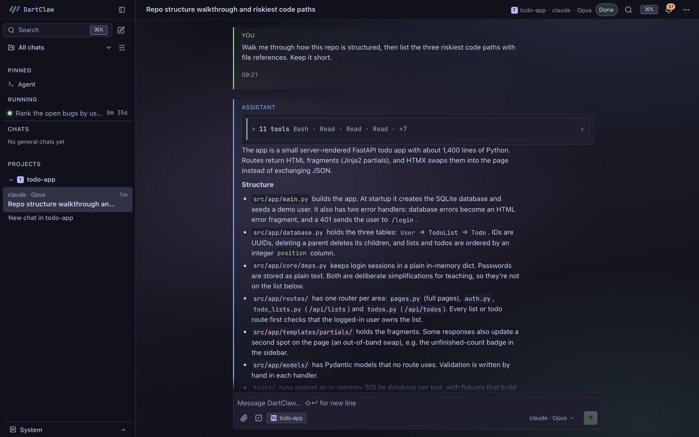
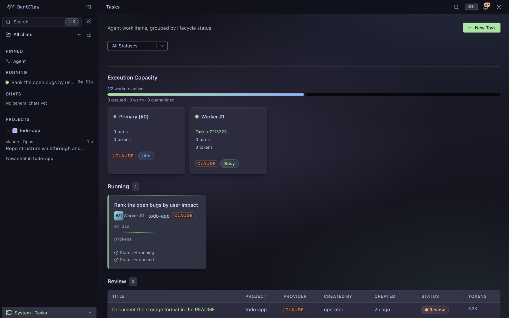
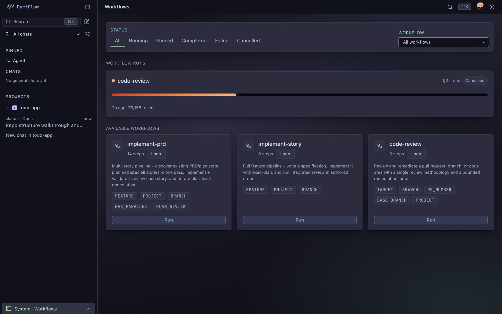
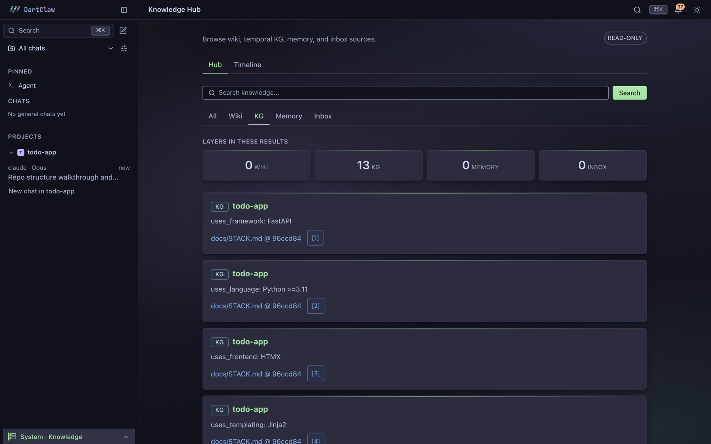
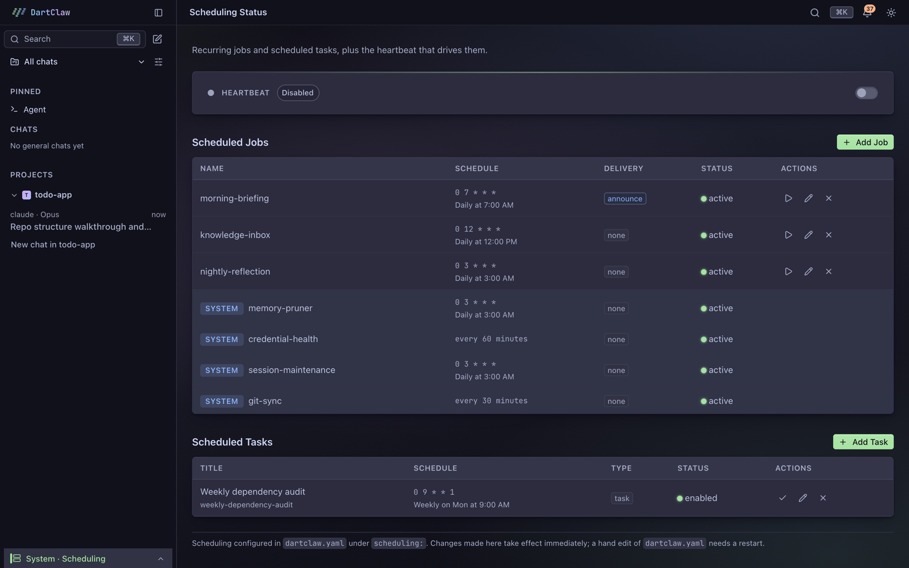
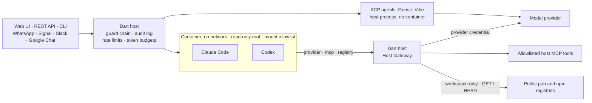

<h1 align="center">
  
</h1>

<p align="center">
  <strong>Agentic powers. No supply-chain roulette. Secure by design.</strong>
</p>

<p align="center">
  <a href="https://github.com/DartClaw/dartclaw/releases"></a>
  
  
  <a href="LICENSE"></a>
</p>

**DartClaw turns the coding agents you already use into a persistent, security-conscious personal AI: equal parts assistant, context engine, and software factory.**

It is self-hosted and runs on the Claude or Codex subscription you already have, or on an API key. It remembers across sessions, works on a schedule and in the background, answers from WhatsApp, Signal, Slack, and Google Chat, and takes a spec to a reviewed pull request. All of it ships as one AOT-compiled Dart binary with its own web UI, REST API, and CLI, and with no Node.js and no npm. Real boundaries stand between the agents and your machine: container isolation, a fail-closed guard chain, and provider credentials that never enter the container.

> [!NOTE]
> DartClaw is **experimental** and pre-1.0. Breaking changes land between releases while the core matures; each one is
> listed in the [CHANGELOG](CHANGELOG.md).

<p align="center">
  
</p>

## What you get

- **Your assistant, on your phone.** Chat in the web UI or over WhatsApp, Signal, Slack, and Google Chat. A team channel gets one shared agent session per thread, and workflow approvals arrive there with Approve and Reject buttons for your admins.
- **It remembers.** The Context Engine keeps an agent-curated wiki, a knowledge graph with history, and long-term memory. Agents get compact answers with citations. You browse the same knowledge in the web UI, as it is now or as it was at any earlier point, and other tools such as your IDE can read it with their own read-only token.
- **It works without you.** Scheduled jobs deliver a morning briefing at 7, scan a knowledge inbox at noon, and reflect on the day overnight. The [recipes](docs/guide/recipes/README.md) are complete setups to copy.
- **A software factory.** Built-in `implement-story`, `implement-prd`, and `code-review` workflows take a spec to reviewed, pull-request-ready code, with approval gates and per-step token accounting. Write your own in YAML and trigger them from chat, a web form, a GitHub PR webhook, or CI, where the standalone `dartclaw-workflow` binary needs no server and no database. The built-ins use skills from the [AndThen](docs/guide/andthen-skills.md) plugin.
- **Background tasks with a review queue.** Hand off work, keep chatting, and accept or reject the result later. A task can run in its own git worktree and on a different provider, so Claude and Codex work side by side.
- **Several agents, one runtime.** Claude Code and Codex are first-class. Goose and Vibe run over the Agent Client Protocol (ACP) as verified, host-only targets. Named agents carry their own model, persona, and private memory, and hand work to each other.
- **Operable from anywhere.** A full web UI with live streaming, a REST API, and a CLI for everything from `serve` to tasks, workflows, and jobs ([CLI reference](docs/guide/cli-reference.md)).

<table>
  <tr>
    <td width="50%"></td>
    <td width="50%"></td>
  </tr>
  <tr>
    <td align="center"><em>Background tasks with a review queue</em></td>
    <td align="center"><em>Spec-to-PR workflows</em></td>
  </tr>
  <tr>
    <td width="50%"></td>
    <td width="50%"></td>
  </tr>
  <tr>
    <td align="center"><em>Knowledge Hub</em></td>
    <td align="center"><em>Scheduled jobs</em></td>
  </tr>
</table>

## Secure by design, not by prompt

Agent frameworks usually ask the model to behave. DartClaw puts the boundaries in the operating system and the host.

- **Containers when you ask for them.** With `container.enabled: true` and Docker or Podman installed, agent turns run in a container with `--network none`, `--cap-drop ALL`, a read-only root filesystem, a non-root user, and a mount allowlist. If the host cannot isolate, the server refuses to start rather than run unisolated. Without that key the agents run on the host with guards but no OS boundary (advisory mode), and the server says so at startup.
- **No credentials in the container.** The Host Gateway serves separate `provider`, `mcp` and `registry` bridge surfaces over host-opened pipes. The host adds credentials to model calls and grants MCP by tool allowlist. Only `workspace` can read public package registries over the mirror. No socket is mounted and no port is published.
- **A fail-closed guard chain.** Command, file, network, and content guards check the agent's tool calls and block when in doubt. The content guard has a model classify what is handed to an agent and what it fetches from the web. Every block lands in the audit log.
- **Runtime governance you switch on.** Per-sender rate limits, daily token budgets, loop detection, and `/stop`, `/pause`, `/resume` commands that the host, not the model, handles on every channel.
- **Nothing fetched at runtime.** One compiled binary carries its web UI, templates, skills, and workflows. A bare install starts with no asset downloads and no first-run network request, and local fitness checks hold dependencies and package boundaries.

Each provider keeps its own documented security posture. ACP agents, for example, run on the host without a container. The [Security guide](docs/guide/security.md) states what each mode does and does not protect.

## Quick start

DartClaw runs on **macOS** (Apple Silicon), **Linux** (x64, arm64), and **Windows** x64. You need:

- at least one agent CLI: [Claude Code](https://code.claude.com/docs) (`claude`) or [Codex CLI](https://github.com/openai/codex) (`codex`)
- **PostgreSQL 14+** for the server ([install guide](docs/guide/postgresql.md)); standalone workflows need no database
- optionally Docker or Podman, for container isolation once you set `container.enabled: true`
- for the built-in coding workflows, the [AndThen](docs/guide/andthen-skills.md) plugin

**1. Create the database.** Run this as a PostgreSQL administrator (`psql postgres` on a Homebrew install):

```sql
CREATE ROLE dartclaw LOGIN PASSWORD '<password>' NOSUPERUSER NOCREATEDB NOCREATEROLE NOREPLICATION;
CREATE DATABASE dartclaw OWNER dartclaw;
\connect dartclaw
CREATE SCHEMA IF NOT EXISTS dartclaw AUTHORIZATION dartclaw;
REVOKE CREATE ON SCHEMA public FROM PUBLIC;
```

**2. Install DartClaw and start it.**

```bash
brew tap DartClaw/dartclaw
brew install dartclaw

# Point DartClaw at the database and create an instance.
export DARTCLAW_DATABASE_URL='postgresql://dartclaw:<password>@127.0.0.1:5432/dartclaw?sslmode=disable'
dartclaw init

# Create the tables and check the setup.
CONFIG=~/.dartclaw/dartclaw.yaml   # the path init printed
dartclaw --config "$CONFIG" doctor --fix

# Use your Claude subscription (or export ANTHROPIC_API_KEY and skip these two lines).
claude setup-token                        # prints a token
dartclaw --config "$CONFIG" auth claude   # paste it at the prompt

dartclaw --config "$CONFIG" serve
# Open http://127.0.0.1:3333
```

For Codex, run `dartclaw --config "$CONFIG" auth codex` or export `CODEX_API_KEY`. [Getting Started](docs/guide/getting-started.md) covers multi-provider setup, the full `init` track with channels, and running as a service.

<details>
<summary><strong>Windows, workflow-only hosts, and source builds</strong></summary>

**Windows x64** via [Scoop](https://scoop.sh):

```powershell
scoop bucket add dartclaw https://github.com/DartClaw/scoop-dartclaw
scoop install dartclaw/dartclaw
```

Or via the checksum-verifying PowerShell installer, which installs under `%LOCALAPPDATA%\Programs\DartClaw` and adds its
`bin` directory to your user `PATH` (re-run it to upgrade):

```powershell
irm https://raw.githubusercontent.com/DartClaw/dartclaw/main/install.ps1 | iex
```

Container isolation is unavailable on native Windows; the [Windows guide](docs/guide/windows.md) lists what works there.

**Workflow-only hosts and CI** use the standalone workflow binary, which needs no server and no database:

```bash
brew install DartClaw/dartclaw/dartclaw-workflow
dartclaw-workflow init
dartclaw-workflow run code-review --json \
  --var TARGET="Review pull request #42 for regressions and missing tests" \
  --var PR_NUMBER=42 --var PROJECT=my-project-id
```

The built-in workflows call skills from the [AndThen](docs/guide/andthen-skills.md) plugin, so install it for the
provider you run.

**From source** (requires the Dart SDK 3.13 or later):

```bash
git clone https://github.com/DartClaw/dartclaw.git && cd dartclaw
dart pub get
bash dev/tools/build.sh
./build/bin/dartclaw --version
```

The build produces `build/bin/dartclaw` and `build/bin/dartclaw-workflow`.

</details>

## How it works

Two layers with a hard trust boundary between them:

- **The Dart host** owns state, the HTTP API, the web UI, security policy, scheduling, channels, task orchestration, and governance.
- **The agent runtime** reasons and runs tools, either inside a container or as a host process.



Without `container.enabled: true`, Claude Code and Codex run as host processes in advisory mode, and the server says so at startup.

One orchestration contract covers every provider, while each keeps its own protocol and capabilities. See [Architecture](docs/guide/architecture.md).

## Make it yours

The agent's personality, standing instructions, and memory are plain Markdown files you can edit and version, in the workspace at `~/.dartclaw/workspace/`: `SOUL.md`, `AGENTS.md`, `USER.md`, `TOOLS.md`, `MEMORY.md`, and `HEARTBEAT.md`.

Everything else is one typed `dartclaw.yaml`. A release-pinned JSON Schema gives your editor completion and validation, and nearly every setting can also be changed from the web UI's Settings page. A minimal file:

```yaml
port: 3333
database:
  url: ${DARTCLAW_DATABASE_URL}
agent:
  provider: claude
  model: sonnet
```

See the [Configuration guide](docs/guide/configuration.md) and [Customization](docs/guide/customization.md).

## Documentation

**User guide** ([full index](docs/guide/README.md))
- [Getting Started](docs/guide/getting-started.md) · [Configuration](docs/guide/configuration.md) · [PostgreSQL](docs/guide/postgresql.md) · [Windows](docs/guide/windows.md) · [Deployment](docs/guide/deployment.md)
- [Security](docs/guide/security.md) · [Governance](docs/guide/governance.md) · [Customization](docs/guide/customization.md)
- [Tasks](docs/guide/tasks.md) · [Workflows](docs/guide/workflows.md) ([YAML reference](docs/guide/workflows-reference.md)) · [Agents](docs/guide/agents.md) · [Projects & Git](docs/guide/projects-and-git.md) · [Scheduling](docs/guide/scheduling.md)
- [Workspace & memory](docs/guide/workspace.md) · [Search](docs/guide/search.md) · [Context Engine](docs/guide/context-engine.md)
- Channels: [WhatsApp](docs/guide/whatsapp.md) · [Signal](docs/guide/signal.md) · [Slack](docs/guide/slack.md) · [Google Chat](docs/guide/google-chat.md)
- [Web UI & API](docs/guide/web-ui-and-api.md) · [CLI Operations](docs/guide/cli-operations.md) · [CLI Reference](docs/guide/cli-reference.md)

**Recipes** ([index](docs/guide/recipes/README.md)): start with the [Personal Assistant](docs/guide/recipes/00-personal-assistant.md), a complete setup with briefings, journaling, research, and reflection. Single-purpose recipes cover a [Morning Briefing](docs/guide/recipes/01-morning-briefing.md), [Daily Journal](docs/guide/recipes/02-daily-memory-journal.md), [Task Queue](docs/guide/recipes/03-scheduled-task-queue.md), [Knowledge Inbox](docs/guide/recipes/04-knowledge-inbox.md), [CRM Tracker](docs/guide/recipes/05-contact-crm-tracker.md), [Research Assistant](docs/guide/recipes/06-research-assistant.md), [Nightly Reflection](docs/guide/recipes/07-nightly-reflection.md), and [Crowd Coding](docs/guide/recipes/08-crowd-coding.md).

**SDK**: build your own agent on DartClaw's packages, starting with the [Quick Start](docs/sdk/quick-start.md). Then see the [Package Guide](docs/sdk/packages.md), [Concepts](docs/sdk/concepts.md), [Architecture](docs/sdk/architecture.md), [Security](docs/sdk/security.md), and the runnable [examples](examples/sdk/).

## Project structure

<details>
<summary>Apps and packages in the Dart workspace</summary>

```
apps/
  dartclaw_cli/          AOT-compilable CLI: serve, init, doctor, auth, workflow, tasks, sessions, jobs, projects, service, …
packages/
  dartclaw/              Client-tier umbrella: re-exports the client and kernel contracts
  dartclaw_client/       Dependency-free HTTP/SSE client for a running server
  dartclaw_kernel/       Shared models, config, guard contracts, and dependency-free utilities
  dartclaw_core/         Provider harnesses, channels, events, PostgreSQL repositories, lexical/hybrid search
  dartclaw_search/       Hybrid search composition, vector sync, and embedding providers
  dartclaw_runtime/      Composition root: HTTP API, web UI, SSE, tasks, scheduling, governance, containers, MCP
  dartclaw_workflow/     Workflow definitions, registry, parser/validator, and execution
  dartclaw_acp/          ACP harness adapter and target admission
  dartclaw_bridge/       Zero-dependency container bridge wire contract
  dartclaw_whatsapp/     WhatsApp channel (GOWA sidecar)
  dartclaw_signal/       Signal channel (signal-cli sidecar)
  dartclaw_slack/        Slack channel (Socket Mode or Events API)
  dartclaw_google_chat/  Google Chat channel (Workspace Events + Pub/Sub)
  dartclaw_testing/      Shared test fakes and utilities
docs/                    User guide and SDK guide
dev/                     Contributor docs, architecture, fitness checks, dev tools, testing profiles
```

</details>

## Development

```bash
dart pub get
dart run dev/tools/embed_assets.dart                                   # generates the embedded asset libraries lib/ imports
dart pub get --directory dev/tools/mascot_favicon --enforce-lockfile   # standalone tool that dart analyze also covers
dart analyze
dart format --line-length=120 --output=none --set-exit-if-changed .
bash dev/tools/test_workspace.sh                                      # the full test tier
```

GitHub `Checks` runs `Check` (dependencies, assets, format, analyze, architecture) and `PowerShell scripts` only.
Tests, fitness and PostgreSQL run locally; the release check's `linux` gate runs local gates and container posture
in a Lima Ubuntu VM on the same commit. A test regression fails the local `tests` gate while GitHub stays green.
The final squash SHA needs both GitHub jobs green; local evidence carries through the release ledger's input
comparison because the squash commit has the branch tip's Git tree.

PostgreSQL contract tests run against a disposable PostgreSQL 14+ service. [Key Development Commands](dev/guidelines/KEY_DEVELOPMENT_COMMANDS.md) lists the faster tiers, single-test runs, and the CI-equivalent gate. Contributor docs live under [`dev/`](dev/).

## Inspirations & influences

Born from spending too much time wrangling AI agents and wondering why the tooling keeps making the same mistakes. These projects and people shaped how DartClaw thinks about the problem:

- **[OpenClaw](https://github.com/openclaw/openclaw)** and **[NanoClaw](https://github.com/nanocoai/nanoclaw)**: two earlier agent runtimes whose architectures, trade-offs, and battle scars directly informed DartClaw's design.
- **Cole Medin**: his work on building agentic systems, and especially his case for building your own agent runtime rather than depending on ever-shifting frameworks. DartClaw exists partly because of that argument.
- **Daniel Miessler**: creator of PAI and a relentless voice for treating AI security as real security, not vibes. The defense-in-depth model here owes a debt to that thinking.
- **[claude_agent_sdk](https://github.com/nshkrdotcom/claude_agent_sdk)**: early exploration of driving the Claude Code binary directly via JSONL, which validated the approach DartClaw's harness is built on.

## License

[MIT](LICENSE)
